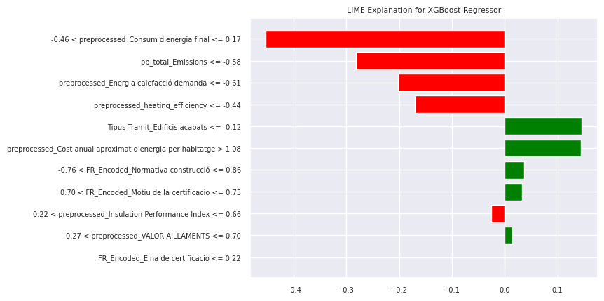

<div align="center">

# 🏠 Catalunya Greenness

### Building Energy Efficiency & CO₂ Emissions Analytics for Catalonia

*A data science pipeline: EDA → renovation text mining → feature engineering → stacked ensemble modeling → interpretability*


<table>
  <tr>
    <td align="center">
      <br>
      <sub>Renovation Measures Before and After Grouping</sub>
    </td>
    <td align="center">
      <br>
      <sub>Energy and CO₂ With and Without Renovation</sub>
    </td>
  </tr>
  <tr>
    <td align="center">
      <br>
      <sub>Energy Ratings by Building Element</sub>
    </td>
    <td align="center">
      <br>
      <sub>Feature Correlation with Final Energy Consumption</sub>
    </td>
  </tr>
  <tr>
    <td align="center">
      <br>
      <sub>CatBoost SHAP Analysis</sub>
    </td>
    <td align="center">
      <br>
      <sub>XGBoost lime Importance</sub>
    </td>
  </tr>
</table>

</div>

---

## 📌 Overview

Buildings account for a large share of energy use and greenhouse gas emissions in the European Union, so improving their efficiency is a key step toward net-zero goals. This project analyzes **over 1.3 million energy-certified buildings in Catalonia (Catalunya)** to answer practical questions:

- Which **renovation measures** are linked to lower energy use and emissions?
- Which measures look **financially efficient**?
- Which **building elements** matter most for energy performance?
- Can we **predict a building's final energy consumption and CO₂ emissions**?

The project covers the full workflow:

1. **Exploratory Data Analysis** of ratings, renovations, provinces, building types, and costs
2. **Renovation text mining:** cleaning, translating (Catalan → English), and grouping messy free-text renovation records
3. **Feature engineering** with encoding, skew correction, and new efficiency features
4. **Stacked ensemble modeling** (Random Forest + XGBoost + CatBoost → Linear Regression)
5. **Interpretability** with SHAP, LIME, and feature importance

> 📄 The full written report with all figures and analysis is available in this repository: `Catalunya-Greenness-Report.pdf`.

---

## 📊 Datasets

| Dataset | Records | Features | Used for |
|---|:---:|:---:|---|
| **Catalunya** (main) | 1,336,925 | 69 | EDA, feature engineering, modeling |
| **Ireland** (supporting) | 1,264,371 | 214 | Building-element analysis (Catalunya lacked these fields) |

**Catalunya feature groups:** geographic information, energy consumption and CO₂ emissions (ratings A–G and continuous values), approximate annual energy cost per home, house features (EV charging, solar, biomass, geothermal, window and façade transmittance), renovation measures, and dates.

**Missing values:** Most columns have few gaps, but 6 columns are over 90% missing, including `ACTUACIONS_REHABILITACIO` (renovation actions, 98.7% missing) and `ANY_CONSTRUCCIO` (year of construction).

---

## 🔍 Key Findings from the EDA

**Renovation measures**
- Only about **1.4% of buildings** (18,326) are recorded as renovated.
- Raw renovation text covered ~1,114 unique categories. After translation and grouping, the **11 most frequent** (≥ 0.05% of records) were kept.
- **Improvement of facilities** (heating, air conditioning, hot water, lighting) shows the lowest CO₂ and final energy use among common measures. It is also the most widely applied (9,000+ homes).
- **Renewal of windows and/or sun protections** shows the weakest results and the highest energy cost per home.
- Renovated buildings show clearly lower non-renewable primary energy, final energy consumption, and CO₂ emissions than non-renovated ones.

**Energy cost**
- Window-focused renovations are among the most expensive options in annual energy cost per home (~10–11), while facade/roof insulation and facility improvements are lower (~7).

**Building elements**
- In Catalunya, buildings with **geothermal installations** and **EV charging points** show the biggest shift toward better (A–B) ratings. District heating and biomass also show positive trends.
- In the Ireland data, **more storeys, chimneys, open flues, and flueless gas fires** are linked to worse ratings, and insulated pitched roofs are linked to better ones.

**Building type, province, and procedure**
- **New constructions** are mostly rated A–B, while **existing buildings** are mostly E–G. Refurbished buildings sit in between.
- Single-family homes rate better than multi-family blocks.
- E is the most common rating in all four provinces (Barcelona, Girona, Lleida, Tarragona), which shows large room for improvement.

---

## 🛠️ Feature Engineering

**Renovation text processing**
1. Removed redundant characters and separators
2. Translated Catalan text to English (`googletrans`)
3. Split multi-renovation records into separate records
4. Grouped similar wording (for example, many photovoltaic variants)
5. Kept categories above a 0.05% frequency threshold and merged the rest into `Other`

**Categorical encoding**

| Type | Features | Method |
|---|:---:|---|
| Ordinal energy / CO₂ ratings (A–G) | 13 | Label encoding (missing values set to `99999`) |
| Low-cardinality nominal | 9 | One-hot encoding |
| High-cardinality nominal | 6 | Frequency encoding |

**Continuous features** (highly right-skewed) went through four steps: negatives set to zero → Box-Cox transform → clip at the 1st and 99th percentiles → standardize.

**New features**
- `age` (2025 minus registration year)
- Efficiency ratios (energy ÷ CO₂) for heating, cooling, lighting, and hot water
- `total_energy` and `total_emissions`

**Feature selection:** kept features with |correlation| ≥ 0.15 to the target (32 features), then removed highly inter-correlated ones to reach a compact final set.

---

## 🤖 Modeling Approach

```
   ┌────────────────┐  ┌────────────────┐  ┌────────────────┐
   │ Random Forest  │  │    XGBoost     │  │    CatBoost    │     ← base models
   └───────┬────────┘  └───────┬────────┘  └───────┬────────┘
           └───────────────────┼───────────────────┘
                               ▼
                    ┌─────────────────────┐
                    │  Linear Regression  │                     ← stacker
                    └──────────┬──────────┘
                               ▼
              Final energy consumption  /  CO₂ emissions
```

- **Targets:** `Consum d'energia final` (final energy consumption) and `Emissions de CO2`
- **Tuning:** grid search on a ~213,900-record subset, then trained on the full data
- **Split:** 80% train / 20% test (267,385 test records)
- **Metrics:** MSE, MAE, R²

---

## 🎯 Results

> Metrics are computed on the **transformed targets** (Box-Cox + standardized), so MSE and MAE are not in kWh/m² or kg CO₂/m². R² is the most comparable number.

### Final Energy Consumption

| Model | MSE | MAE | R² |
|---|:---:|:---:|:---:|
| Random Forest | 0.5702 | 0.0441 | 0.217 |
| CatBoost | 0.0839 | 0.1104 | 0.798 |
| XGBoost | 0.0735 | 0.1265 | 0.818 |
| **Stacked Ensemble** | **0.0408** | **0.0657** | **0.898** |

### CO₂ Emissions

| Model | MSE | MAE | R² |
|---|:---:|:---:|:---:|
| Random Forest | 0.1209 | 0.1374 | 0.733 |
| CatBoost | 0.8340 | 0.0264 | 0.005 |
| XGBoost | 0.1952 | 0.2029 | 0.576 |
| **Stacked Ensemble** | **0.1195** | **0.1375** | **0.736** |

**Takeaways**
- The **stacked ensemble** is the best or tied-best model for both targets.
- For energy consumption, the top predictors are CO₂ emissions, annual energy cost, and building age. For CO₂, the top predictor is final energy consumption.
- CatBoost performed very well on energy consumption but failed on CO₂ (R² ≈ 0.005), and Random Forest had a very low R² on energy consumption. Both are worth investigating further.

---

## ⚠️ Limitations

- **Close link between targets:** Energy consumption and CO₂ emissions are tightly related, and each model uses the other as a top predictor. Results show how well the models fit these relationships, not an independent forecast.
- **Transformed-scale metrics:** Errors are not reported in original units.
- **Observational renovation analysis:** Renovation comparisons use group averages, not before-and-after data. Only ~1.4% of buildings have renovation records.
- **Cost variable:** The dataset holds approximate **annual energy cost per home**, not renovation investment cost. "Financial efficiency" here means energy-cost level, not payback.
- **Building-element analysis** relies on the Ireland dataset, so findings may not transfer directly to Catalonia.
- **Automated translation** and text grouping are imperfect, and some rare categories remain.

---

## 🚀 Future Work

- Report errors on the **original scale** and add cross-validation
- Re-run models **without the closely linked target-derived features** to test true predictive power
- Investigate why **CatBoost fails on the CO₂ target** and why RF underperforms on energy consumption
- Add **renovation cost and before/after data** for a real cost-effectiveness analysis
- Add **geospatial analysis** at the county and municipality level

---

## 📁 Repository Structure

```
Catalunya-Greenness/
│
├── src/                                    # All notebooks
│   ├── Catalonia_data.ipynb                # Data loading and preparation
│   ├── Catalunia_EDA.ipynb                 # Main exploratory data analysis
│   ├── Catalunya__additional_EDA.ipynb     # Additional EDA (building elements, appendix)
│   ├── Renovation_Feature_Engineering.ipynb  # Renovation text processing and features
│   ├── Energy_Consumption_Model.ipynb      # Final energy consumption models
│   └── CO2_Emission_Model.ipynb            # CO₂ emission models
│
├── images/                                 # Figures used in this README
│
├── Catalunya-Greenness-Report.pdf          # Full project report
└── README.md
```

---

## ▶️ Getting Started

**1. Clone the repository**
```bash
git clone https://github.com/malihealavi/Catalunya-Greenness.git
cd Catalunya-Greenness
```

**2. Install dependencies**
```bash
pip install numpy pandas scipy matplotlib seaborn scikit-learn xgboost catboost shap lime googletrans jupyter
```

**3. Run the notebooks in `src/` in this order**

| Step | Notebook | Purpose |
|:---:|---|---|
| 1 | `Catalonia_data.ipynb` | Load and prepare the data |
| 2 | `Catalunia_EDA.ipynb`, `Catalunya__additional_EDA.ipynb` | Explore the data |
| 3 | `Renovation_Feature_Engineering.ipynb` | Clean renovation text and build features |
| 4 | `Energy_Consumption_Model.ipynb` | Train and evaluate energy models |
| 5 | `CO2_Emission_Model.ipynb` | Train and evaluate CO₂ models |

> The datasets are large and are not stored in this repository.

---

## 🧰 Tech Stack

`Python` · `Pandas` · `NumPy` · `SciPy` · `Scikit-learn` · `XGBoost` · `CatBoost` · `SHAP` · `LIME` · `Matplotlib` · `Seaborn` · `Googletrans` · `Jupyter`

---

## 👩‍💻 Author

**Malihe Alavi**
Data Scientist — Medical Imaging & Applied Machine Learning

🔗 GitHub: [@malihealavi](https://github.com/malihealavi)

---

<div align="center">

⭐ If you find this project useful, consider giving it a star!

</div>
